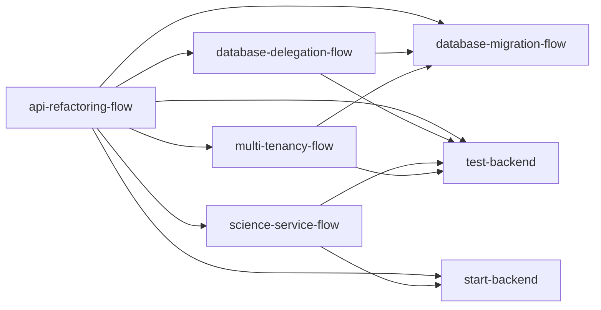

---
description:
---

# 📘 Workflow Index — Finance Dashboard

**Ultimo aggiornamento**: 2026-07-11

Questo documento funge da indice centralizzato per tutti i workflow del progetto, con lo stato temporale di avanzamento dei lavori e la mappa delle dipendenze.

---

## 🗂️ Workflow Disponibili

| Workflow | Slash Command | Descrizione | Quando Usare |
|----------|---------------|-------------|--------------|
| [api-refactoring-flow.md](api-refactoring-flow.md) | `/api-refactoring-flow` | Audit incrementale delle API NestJS + Python | Quando si analizza, refactora o valida una singola API |
| [database-delegation-flow.md](database-delegation-flow.md) | `/database-delegation-flow` | Migrazione logiche in-memory → PostgreSQL | Quando si identificano aggregazioni/filtri in-memory da ottimizzare |
| [database-migration-flow.md](database-migration-flow.md) | `/database-migration-flow` | Gestione migrazioni Prisma, reset e seed | Quando si modifica lo schema Prisma |
| [start-backend.md](start-backend.md) | `/start-backend` | Avvio ambiente di sviluppo Docker | Quando si inizia una sessione di sviluppo |
| [test-backend.md](test-backend.md) | `/test-backend` | Esecuzione test unitari e E2E | Quando si valida il codice prima del commit |
| [science-service-flow.md](science-service-flow.md) | — | Sviluppo e audit del modulo Python/FastAPI | Quando si lavora sul servizio Science o sulla sua integrazione con NestJS |
| [multi-tenancy-flow.md](multi-tenancy-flow.md) | — | Sviluppo di funzionalità multi-tenant | Quando si implementa l'isolamento dei dati per utente o query custom |

---

## 🔗 Mappa delle Dipendenze

---

## 📊 Stato Avanzamento — API Refactoring Audit

Questa sezione traccia lo stato temporale dell'audit incrementale delle API, come definito in [api-refactoring-flow.md](api-refactoring-flow.md).

| Step | Modulo | Endpoint Principali | Stato | Ultimo Aggiornamento | GitHub Issues |
|------|--------|---------------------|-------|---------------------|---------------|
| 1 | Upload API | `POST /transactions/upload` | 🟢 COMPLETATO | 2026-05-27 | — |
| 2 | CRUD Transactions | `POST/PATCH/DELETE /transactions` | 🟢 COMPLETATO | 2026-07-05 | [#73](https://github.com/fabogit/finances-dashboard/issues/73) |
| 3 | Categorie & Subcategorie | `GET/POST/DELETE /categories` | 🟢 COMPLETATO | 2026-07-11 | [#73](https://github.com/fabogit/finances-dashboard/issues/73) |
| 4 | Assets & Conti | `GET/POST/PATCH /assets` | 🟢 COMPLETATO | 2026-07-11 | [#60](https://github.com/fabogit/finances-dashboard/issues/60) ✅ |
| 5 | Savings Goals | `GET/POST /goals`, `GET /goals/:id/projection` | 🟢 COMPLETATO | 2026-07-11 | [#73](https://github.com/fabogit/finances-dashboard/issues/73) |
| 6 | Analytics | `GET /analytics/cashflow`, `GET /analytics/categories` | 🟡 IN CORSO | 2026-07-11 | — |
| 7 | Science Proxy | `POST /science/*` (proxy NestJS → FastAPI) | ⚪ DA INIZIARE | — | — |

### Dettaglio Lavori Completati

#### Step 1: Upload API (🟢)
- Ottimizzato parsing date sul servizio Python
- Introdotto `transactionHash` SHA-256 per prevenire duplicati
- Aggiornamenti bilanci asset e savings goals tramite `$transaction` atomica
- Delegato raggruppamento/somma importi al database via Prisma `groupBy`
- Separata logica reperimento categorie nel repository (SRP)

#### Step 2: CRUD Transactions (🟢)
- Implementate operazioni manuali di creazione, aggiornamento e cancellazione.
- Introdotta la logica di reversione automatica del saldo in Prisma `$transaction` in caso di cancellazione o variazione importo/asset/goal.
- Scritta copertura test unitari e test E2E (`crud-transactions.e2e-spec.ts`).
- Ottimizzata logica update: calcolo delta anziché full revert+reapply quando asset/goal invariati.

#### Step 3: Categories & Subcategories (🟢)
- Aggiunto `systemKey String?` e `userId String @default("demo_user")` al modello Category.
- Vincolo unique aggiornato a `@@unique([name, parentId, userId])`.
- Implementato delete re-routing con `reassignToId` e fallback a `UNCATEGORIZED`.
- Protezione `isSystem` — categorie di sistema non eliminabili.
- Unit test + E2E aggiornati.

#### Step 4: Assets & Accounts (🟢)
- Aggiunto `isOnBudget Boolean @default(true)` al modello Asset.
- Implementato Daily Closing Balance (`upsertHistorySnapshot`) — un solo record per asset/giorno.
- DTO aggiornati con Swagger metadata.

#### Step 5: Savings Goals (🟢)
- Guard-rails Python: `months_remaining > 1200 / inf / nan` → payload sicuro.
- Previene crash `OutOfBoundsDatetime` di Pandas.

#### Step 6: Analytics (🟡 In Corso)
- ✅ Ottimizzato calcolo trend mensili (`getMonthlyTrends`) con delegazione al DB via Prisma `groupBy` (2026-05-31)
- ✅ Tipi di ritorno espliciti su tutti i metodi repository (2026-07-11)
- ⬜ Restano da auditare: cashflow aggregation, category distribution, budget analysis queries

---

## 📊 Stato Avanzamento — Feature Pipeline

Tracciamento delle feature pianificate e del loro stato rispetto alle [milestone GitHub](https://github.com/fabogit/finances-dashboard/milestones).

### Milestone Completate

| # | Milestone | Issues | Stato |
|---|-----------|--------|-------|
| 1 | Phase 1: Foundations & Data Ingestion | 8/8 ✅ | 🟢 Chiusa |
| 2 | Phase 2: Python Science Service & Core Integration | 6/6 ✅ | 🟢 Chiusa |
| 3 | Phase 3: Data Persistence & Business Logic | 6/6 ✅ | 🟢 Chiusa |
| 4 | Phase 4: Analytics, CRUD & Dashboard APIs | 8/8 ✅ | 🟢 Chiusa |
| 5 | Phase 5: Budgeting System & Advanced Category Management | 10/10 ✅ | 🟢 Chiusa |
| 6 | Phase 6: Quality Assurance & CI/CD Pipeline | 10/10 ✅ | 🟢 Chiusa |

### Milestone Aperte

| # | Milestone | Open | Closed | Stato |
|---|-----------|------|--------|-------|
| 7 | Phase 7: Wealth Management & Goal Setting | 8 | 4 | 🟡 In Corso |
| 8 | Phase 8: Security, Authentication & Multi-tenancy | 4 | 0 | ⚪ Non iniziata |
| 9 | Phase 9: Advanced Features & Tauri Desktop | 1 | 0 | ⚪ Non iniziata |

### Issues Aperti (Dettaglio)

| Issue | Milestone | Descrizione | Stato Codice |
|-------|-----------|-------------|--------------|
| [#73](https://github.com/fabogit/finances-dashboard/issues/73) | Phase 7 | Epic: API Refactoring & Audit Workflow | 🟡 In corso (Steps 1-5 completati, 6-7 da fare) |
| [#60](https://github.com/fabogit/finances-dashboard/issues/60) | Phase 7 | Asset Value History (Daily Closing Balance) | ✅ Implementato (Step A2) — da chiudere |
| [#61](https://github.com/fabogit/finances-dashboard/issues/61) | Phase 7 | Net Worth Analytics (Multi-Currency) | ⚪ Da iniziare |
| [#74](https://github.com/fabogit/finances-dashboard/issues/74) | Phase 7 | Internal Transfers (Double Transaction Model) | ⚪ Da iniziare |
| [#75](https://github.com/fabogit/finances-dashboard/issues/75) | Phase 7 | Budget Rules Standalone API Module | ⚪ Da valutare |
| [#77](https://github.com/fabogit/finances-dashboard/issues/77) | Phase 7 | Refactor Forecast: Split Trend/Recurrence + Guard-Rail | ⚪ Da iniziare |
| [#78](https://github.com/fabogit/finances-dashboard/issues/78) | Phase 7 | Subscriptions Module (CRUD & Forecast Suppression) | ⚪ Da iniziare |
| [#80](https://github.com/fabogit/finances-dashboard/issues/80) | Phase 7 | [API] HTTP QUERY Method for Transactions (RFC 9435) | ⚪ Da iniziare |
| [#81](https://github.com/fabogit/finances-dashboard/issues/81) | Phase 7 | [Database] ExchangeRate Model and Manual CRUD API | ⚪ Da iniziare |
| [#62](https://github.com/fabogit/finances-dashboard/issues/62) | Phase 8 | User Management & Auth Foundation | ⚪ Da iniziare |
| [#63](https://github.com/fabogit/finances-dashboard/issues/63) | Phase 8 | Multi-Tenancy Refactoring | ⚪ Da iniziare |
| [#64](https://github.com/fabogit/finances-dashboard/issues/64) | Phase 8 | RBAC | ⚪ Da iniziare |
| [#65](https://github.com/fabogit/finances-dashboard/issues/65) | Phase 8 | Demo Sandbox Strategy | ⚪ Da iniziare |
| [#79](https://github.com/fabogit/finances-dashboard/issues/79) | Phase 9 | Local Rule Engine for Transaction Categorization | ⚪ Da iniziare |

---

## 🟢 Gap: All Gaps Resolved

Tutti i gap precedentemente rilevati tra codice locale, documentazione e issue di GitHub sono stati risolti e sincronizzati. Non ci sono più ticket mancanti sul server remoto.

---

## 📚 Documentazione Correlata

| Documento | Percorso | Contenuto |
|-----------|----------|-----------|
| **Execution Plan** | [2026-07-05-roadmap-execution-plan.md](../../docs/superpowers/plans/2026-07-05-roadmap-execution-plan.md) | **Piano operativo con sequenza di esecuzione** |
| Architecture | [fn_architecture.md](../../documents/fn_architecture.md) | Architettura del sistema e diagrammi |
| Data Dictionary | [fn_data_dictionary.md](../../documents/fn_data_dictionary.md) | Modelli dati, enum, relazioni |
| Product Roadmap | [fn_product_roadmap.md](../../documents/fn_product_roadmap.md) | User journey e roadmap evolutiva |
| Science Integration | [fn_science_integration.md](../../documents/fn_science_integration.md) | Protocollo comunicazione Python |
| System State (Latest) | [2026-07-11_system.md](../../docs/superpowers/status/2026-07-11_system.md) | Snapshot stato sistema aggiornato |

