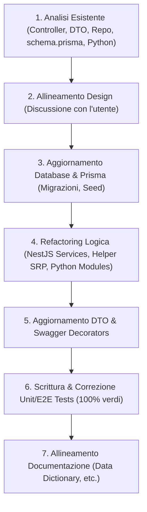

# API Refactoring & Audit Workflow

Questa guida definisce la procedura standard e l'ordine sequenziale per eseguire l'analisi, il refactoring della qualità del codice e la validazione di ogni singola API dell'applicazione. Seguendo questo workflow, è possibile riprendere il lavoro da qualsiasi punto e garantire standard qualitativi elevati e uniformi.

---

## 📋 Prerequisiti

- Container Docker avviati e in salute (vedi [start-backend.md](start-backend.md))
- Database PostgreSQL raggiungibile e con le migrazioni applicate
- File `.env.local` configurato in `backend-core/`

---

## 🛠️ Skill e Workflow da Consultare

### Pianificazione e Design
* Utilizzare la skill [brainstorming](../skills/brainstorming/SKILL.md) prima di proporre e implementare modifiche strutturali o nuove logiche.
* Utilizzare la skill [writing-plans](../skills/writing-plans/SKILL.md) per definire piani di implementazione dettagliati e sequenziali per modifiche multi-step.

### Sviluppo Backend (NestJS & Node.js)
* Utilizzare la skill [nestjs-best-practices](../skills/nestjs-best-practices/SKILL.md) per i pattern di Dependency Injection, organizzazione dei moduli e gestione degli errori NestJS.
* Utilizzare la skill [backend-core-dev](../skills/backend-core-dev/SKILL.md) per l'implementazione dei controller, dei DTO e del Repository Pattern.
* Utilizzare la skill [node](../skills/node/SKILL.md) per le best practices di TypeScript nativo su Node.js e la gestione asincrona.
* Utilizzare la skill [typescript-magician](../skills/typescript-magician/SKILL.md) per risolvere errori del compilatore TypeScript, digitare correttamente i tipi complessi ed evitare l'utilizzo di `any`.

### Database & ORM (Prisma)
* Utilizzare la skill [prisma-cli](../skills/prisma-cli/SKILL.md) per eseguire migrazioni, push del database o seed.
* Utilizzare la skill [prisma-client-api](../skills/prisma-client-api/SKILL.md) per la corretta scrittura di query complesse, filtri e transazioni ACID (`$transaction`).
* Utilizzare la skill [postgresql-optimization](../skills/postgresql-optimization/SKILL.md) per l'ottimizzazione di performance di query SQL complesse, indici ed espressioni a livello database.

### Sviluppo Scientifico (Python & FastAPI)
* Utilizzare la skill [fastapi](../skills/fastapi/SKILL.md) per lo sviluppo e l'audit dei microservizi Python FastAPI e dei relativi modelli Pydantic.
* Utilizzare la skill [pandas-pro](../skills/pandas-pro/SKILL.md) per l'elaborazione dei dati tabulari tramite DataFrame in Pandas.

### Operatività e Test
* Utilizzare la skill [backend-core-ops](../skills/backend-core-ops/SKILL.md) per la gestione dei container Docker e l'esecuzione degli script di test.

### Processi e Controllo Qualità (Meta-Skill)
* Utilizzare la skill [using-superpowers](../skills/using-superpowers/SKILL.md) all'inizio di ogni interazione per orientarsi sulle skill e linee guida disponibili.
* Utilizzare la skill [executing-plans](../skills/executing-plans/SKILL.md) (o [subagent-driven-development](../skills/subagent-driven-development/SKILL.md)) per gestire l'esecuzione tramite piani di lavoro strutturati ed checkpoint di verifica.
* Utilizzare la skill [verification-before-completion](../skills/verification-before-completion/SKILL.md) per verificare formalmente i risultati e far girare unit/E2E test prima di validare lo step e committare le modifiche.

### Workflow di Supporto
* Utilizzare il workflow [database-delegation-flow.md](database-delegation-flow.md) per guidare l'ottimizzazione e la migrazione di calcoli o aggregazioni in-memory verso PostgreSQL.
* Utilizzare il workflow [database-migration-flow.md](database-migration-flow.md) per la gestione di migrazioni Prisma, reset del database e seed.
* Utilizzare il workflow [science-service-flow.md](science-service-flow.md) per lo sviluppo e l'audit del modulo Python/FastAPI.

---

## 📦 Protocollo di Refactoring per Singola API

Per ogni API analizzata, seguire tassativamente le seguenti fasi:



### 1. Analisi dell'Esistente
*   Ispezionare il Controller per verificare le rotte, i parametri e i decorator. Utilizzare le indicazioni delle skill [backend-core-dev](../skills/backend-core-dev/SKILL.md) e [nestjs-best-practices](../skills/nestjs-best-practices/SKILL.md).
*   Ispezionare il Service e il Repository per valutare la qualità, la leggibilità e l'aderenza al **Single Responsibility Principle (SRP)**.
*   **Audit Delegazione al Database**: Identificare qualsiasi logica di elaborazione dati in-memory (es. raggruppamenti, conteggi, cicli di somma `Map`/`forEach`, ordinamenti, filtri manuali) che possa essere ottimizzata delegandola a PostgreSQL. Seguire la **Fase 1: Identificazione** di [database-delegation-flow.md](database-delegation-flow.md) per scovare questi code smell.
*   Controllare il modello Prisma in `schema.prisma` e valutare la presenza di indici o vincoli.
*   Ispezionare l'eventuale codice Python associato (`backend-science/src/modules/`) valutando la robustezza del parsing e delle elaborazioni.

### 2. Allineamento del Design
*   Utilizzare la skill [brainstorming](../skills/brainstorming/SKILL.md) per analizzare i requisiti e documentare le debolezze rilevate (es. N+1 queries, mancanza di transazioni ACID, accoppiamento eccessivo).
*   Presentare all'utente le opzioni di miglioramento e attendere approvazione prima di procedere con le modifiche strutturali.

### 3. Aggiornamento del Database (Prisma)
*   Se necessario, modificare `schema.prisma`.
*   Applicare le modifiche con una migrazione:
    > *Esegui dalla directory `backend-core/`:*
    ```fish
    pnpm run prisma:migrate
    ```
    Oppure per spingere le modifiche senza creare una migrazione (prototipazione rapida):
    > *Esegui dalla directory `backend-core/`:*
    ```fish
    pnpm run prisma:push
    ```
*   **Seeding**: All'avvio del container Docker, il seed del database viene eseguito automaticamente. Per eseguirlo manualmente:
    > *Esegui dalla directory `backend-core/`:*
    ```fish
    pnpm run prisma:seed
    ```
*   Se applicabile, aggiornare il file di Seed (`prisma/seed.ts`).

### 4. Refactoring della Logica
*   **Delega al Database (Repository Pattern)**: Se sono state identificate logiche delegabili al database, implementarle seguendo la procedura di [database-delegation-flow.md](database-delegation-flow.md).
    - Consultare la **Fase 2** di tale workflow per scegliere lo strumento corretto (Prisma API vs `$queryRaw` vs CTE).
    - Rispettare le linee guida di sicurezza della **Fase 3** per la prevenzione di SQL injection (utilizzo obbligatorio di `Prisma.sql` e query parametrizzate) e la corretta gestione dei valori nulli e precisione decimale (es. `COALESCE` e tipi `Prisma.Decimal`).
    - Applicare la separazione delle responsabilità della **Fase 4** mantenendo la query/aggregazione nel Repository e il parsing/DTO-mapping nel Service.
    > [!IMPORTANT]
    > **Separation of Concerns (Logica DB nel Repository)**: Per rispettare l'architettura NestJS, tutte le query complesse, aggregazioni (es. `groupBy`), operazioni raw SQL (`$queryRaw`) e ordinamenti **devono risiedere all'interno del Repository** (es. `TransactionsRepository`) e mai nel `Service`. Il `Service` invocherà i metodi del repository passando l'oggetto `tx` della transazione per mantenere la transazionalità.
    *   *Nota*: Eseguire la delegazione database in questa fase previene la riscrittura duplicata degli unit test.
*   Isolare le responsabilità complesse in helper privati o moduli dedicati.
*   Garantire l'atomicità delle operazioni di scrittura (es. aggiornamento simultaneo di transazioni e saldi degli asset) tramite `$transaction` di Prisma (consultando la skill [prisma-client-api](../skills/prisma-client-api/SKILL.md)).
*   Garantire una forte tipizzazione eliminando l'uso di `any` e gestendo esplicitamente i tipi (es. `Prisma.Decimal`) usando le skill [typescript-magician](../skills/typescript-magician/SKILL.md) e [node](../skills/node/SKILL.md).
*   **Uso di Branded Types per gli ID**: Utilizzare i branded types definiti in [branded.types.ts](../../backend-core/src/common/types/branded.types.ts) (es. `AssetId`, `CategoryId`, `TransactionId`) per tutti i parametri dei metodi, variabili dei service e tipi di ritorno dei repository che rappresentano identificatori di entità del database. Questo garantisce type safety assoluta a tempo di compilazione impedendo lo scambio accidentale di diversi tipi di UUID.
*   Se le modifiche toccano il codice Python o le manipolazioni di DataFrame, consultare le skill [fastapi](../skills/fastapi/SKILL.md) e [pandas-pro](../skills/pandas-pro/SKILL.md).

### 5. DTO e Documentazione Swagger
*   Aggiornare o creare i DTO in `src/modules/.../dto/`.
*   Aggiungere i decorator `@ApiProperty(...)` di `@nestjs/swagger` per documentare i tipi, gli esempi e l'opzionalità dei campi.
*   Utilizzare `@Expose()` di `class-transformer` per assicurare che vengano restituiti solo i dati previsti.
*   **Validazione Documentazione**: Una volta avviati i servizi, verificare la correttezza dello schema OpenAPI generato negli endpoint interattivi:
    - NestJS Core Swagger: `http://localhost:3000/api`
    - Python Science Swagger: `http://localhost:8000/docs`

### 6. Validazione e Test (100% Verdi)
*   Aggiornare o aggiungere i test Jest in `*.spec.ts`.
    - **Unit Test dei Servizi**: Aggiornare i mock dei repository per supportare i nuovi metodi aggregati e verificare la corretta gestione dei tipi decimali restituiti (come indicato nella **Fase 5** di [database-delegation-flow.md](database-delegation-flow.md)).
    - **Unit Test dei Repository**: Testare la corretta costruzione delle query dinamiche o chiamate a `groupBy` mockando il Prisma Client.
*   Eseguire i test unitari:
    > *Esegui dalla directory `backend-core/`:*
    ```fish
    pnpm test
    ```
*   Eseguire i test E2E (NestJS) per verificare l'integrazione e il comportamento reale del database:
    > *Esegui dalla directory `backend-core/`:*
    ```fish
    pnpm run test:e2e:docker
    ```
*   Se sono state apportate modifiche al codice Python, eseguire i test unitari del servizio Science:
    > *Esegui dalla directory `backend-science/` (con `direnv` attivo):*
    ```fish
    pytest
    ```
*   Assicurarsi che la formattazione e le regole di lint siano rispettate senza errori o avvertenze:
    > *Esegui dalla directory `backend-core/`:*
    ```fish
    pnpm run lint
    ```

### 7. Aggiornamento della Documentazione di Progetto
*   Aggiornare [fn_data_dictionary.md](../../documents/fn_data_dictionary.md) in caso di modifiche al modello dati.
*   Se sono state introdotte o modificate variabili d'ambiente, assicurarsi di allineare i rispettivi file di template/esempio (es. `.env.compose_example`, `backend-core/.env.local_example`, `backend-core/.env.test_example`).
*   Aggiornare il `walkthrough.md` della conversazione corrente per riassumere i risultati ottenuti.

---

## 🗺️ Roadmap dei Moduli (Ordine Logico del Flusso Dati)

Seguire questo ordine sequenziale per l'audit delle API. Per lo stato di avanzamento temporale dettagliato, consultare il [README.md](README.md) dei workflow.

### Step 1: Caricamento e Importazione dei Dati (Upload API)
*   **Endpoint principale**: `POST /transactions/upload`
*   **Stato**: 🟢 **COMPLETATO**
*   **Cosa è stato fatto**:
    *   Ottimizzato il parsing delle date sul microservizio Python.
    *   Introdotto `transactionHash` SHA-256 univoco per prevenire importazioni duplicate.
    *   Gestiti in modo atomico (`$transaction`) gli aggiornamenti dei bilanci degli asset e della progressione dei savings goals.
    *   **Delega al Database**: Ottimizzato il calcolo dei saldi all'importazione delegando il raggruppamento e la somma di importi (per asset e per goal) al database tramite Prisma `groupBy` (invece dell'aggregazione in-memory con `Map` e `forEach`), in accordo con [database-delegation-flow.md](database-delegation-flow.md).
    *   Separata la logica di reperimento categorie nel repository (SRP).

### Step 2: Gestione Manuale delle Transazioni (CRUD Transactions)
*   **Endpoint principali**:
    *   `POST /transactions` (Creazione manuale)
    *   `PATCH /transactions/:id` (Modifica)
    *   `DELETE /transactions/:id` (Eliminazione)
*   **Stato**: ⚪ **DA INIZIARE**
*   **Obiettivi di Audit**:
    *   Verificare che la logica di storno/applicazione dei bilanci in caso di modifica o eliminazione (già presente tramite `$transaction`) sia matematicamente robusta (es. inversione del segno dell'importo originale prima di applicare il nuovo importo).
    *   Analizzare l'integrazione con la selezione manuale delle categorie e verificare se l'utente può forzare categorie personalizzate.
    *   Validare la consistenza del database in caso di eliminazione orfana.

### Step 3: Gestione delle Categorie e Subcategorie
*   **Endpoint principali**:
    *   `GET /categories`
    *   `POST /categories`
    *   `DELETE /categories/:id`
*   **Stato**: ⚪ **DA INIZIARE**
*   **Obiettivi di Audit**:
    *   Verificare la logica di protezione `isSystem` per le categorie predefinite del sistema.
    *   Analizzare la performance e la struttura ricorsiva della gerarchia categorie/subcategorie (prevenzione di query N+1 nella costruzione dell'albero). Valutare l'uso di PostgreSQL Common Table Expressions (CTE) se necessario, come indicato in [database-delegation-flow.md](database-delegation-flow.md).
    *   Audit della gestione delle regole di budget collegate alle categorie.

> [!NOTE]
> **Budget Rules**: Il modello `BudgetRule` esiste nello schema Prisma ed è accoppiato alle `Category` (relazione 1:1). L'audit dovrà valutare la creazione di un **modulo dedicato** (`BudgetModule`) per esporre CRUD API standalone sulle regole di budget, separandole logicamente dal modulo categorie. L'implementazione verrà eseguita una volta completata la logica mancante.

### Step 4: Gestione Asset e Conti (Assets Module)
*   **Endpoint principali**:
    *   `GET /assets`
    *   `POST /assets`
    *   `PATCH /assets/:id`
*   **Stato**: ⚪ **DA INIZIARE**
*   **GitHub Issues**: [#60 Asset & Liability Tracking](https://github.com/fabogit/finances-dashboard/issues/60), [#61 Net Worth Analytics](https://github.com/fabogit/finances-dashboard/issues/61)
*   **Obiettivi di Audit**:
    *   Audit del calcolo della Ricchezza Netta (Net Worth) complessiva. Spostare eventuali calcoli aggregati in-memory a livello di query SQL/Prisma.
    *   Implementazione/verifica del supporto multi-valuta (es. EUR/USD) e cron job per il recupero dei tassi di cambio.
    *   Ispezione della storicizzazione del valore dell'asset (`AssetHistory`).

> [!NOTE]
> **Trasferimenti Interni**: Il design prevede l'aggiunta di `isTransfer` e `destinationAssetId` al modello `EnrichedTransaction` (vedi [implementation_plan.md](../../docs/implementation_plan.md)). L'audit dovrà prevedere l'integrazione di questa logica atomica per lo spostamento fondi tra asset. L'implementazione verrà eseguita una volta completata la logica mancante e creato il relativo issue GitHub.

### Step 5: Obiettivi di Risparmio (Savings Goals)
*   **Endpoint principali**:
    *   `GET /goals`
    *   `POST /goals`
    *   `GET /goals/:id/projection` (Integrazione Python)
*   **Stato**: ⚪ **DA INIZIARE**
*   **Obiettivi di Audit**:
    *   Analizzare la query di regressione lineare implementata sul servizio Python (`/goals/projection`).
    *   Verificare come vengono calcolate le velocità di risparmio medie mensili e l'affidabilità (confidence score), valutando se spostare aggregazioni temporali e medie su PostgreSQL.
    *   Gestione dei casi limite (es. obiettivi con progressione negativa o nulla).

### Step 6: Statistiche e Analytics
*   **Endpoint principali**:
    *   `GET /analytics/cashflow`
    *   `GET /analytics/categories`
*   **Stato**: 🟡 **IN CORSO**
*   **Obiettivi di Audit**:
    *   Assicurarsi che le transazioni segnate come trasferimenti interni (`isTransfer == true`) siano correttamente escluse dai calcoli di entrate/uscite globali.
    *   Verificare le query di aggregazione mensile per garantire performance elevate su dataset storici molto ampi. Applicare rigorosamente le query raw SQL aggregate con `DATE_TRUNC`/`TO_CHAR` e `COALESCE` nel repository (anziché in-memory), in accordo con la **Fase 2** di [database-delegation-flow.md](database-delegation-flow.md).
*   **Lavoro già completato**:
    *   Ottimizzato il calcolo dei trend mensili (`getMonthlyTrends`) delegando l'aggregazione al database tramite Prisma `groupBy` (2026-05-31).

### Step 7: Modulo Science Proxy
*   **Endpoint principali**:
    *   `POST /science/process` (Proxy verso Python `/process`)
    *   `POST /science/forecast` (Proxy verso Python `/forecast`)
    *   `POST /science/goals/projection` (Proxy verso Python `/goals/projection`)
*   **Stato**: ⚪ **DA INIZIARE**
*   **Obiettivi di Audit**:
    *   Verificare la resilienza del proxy NestJS → FastAPI (`ScienceService`): timeout, retry, fallback in caso di servizio Python offline.
    *   Analizzare la qualità dei DTO di input/output per il passaggio dati tra i due servizi.
    *   Verificare che gli errori del servizio Python vengano gestiti e loggati correttamente senza esporre informazioni sensibili all'utente.
    *   Consultare il workflow [science-service-flow.md](science-service-flow.md) per i pattern del modulo Python.

---

## 🧪 Validazione

Per ogni step di audit completato, verificare:
1. Tutti i test unitari passano: `pnpm test` (da `backend-core/`)
2. Tutti i test E2E passano: `pnpm run test:e2e:docker` (da `backend-core/`)
3. Lint passa senza errori: `pnpm run lint` (da `backend-core/`)
4. Se modifiche Python: `pytest` (da `backend-science/`)
5. Swagger UI mostra correttamente le API aggiornate

---

## ❓ Troubleshooting

| Problema | Causa | Soluzione |
|----------|-------|-----------|
| Test E2E appesi | Container test DB zombie | `docker ps` → `docker rm -f` il container sulla porta 5433 |
| `P3009` migration error | Conflitto migrazioni | Seguire [database-migration-flow.md](database-migration-flow.md) sezione Hard Reset |
| Swagger non aggiornato | DTO non decorati | Verificare `@ApiProperty()` su tutti i campi |
| Science service offline | Container non avviato | `docker logs fn-science` per diagnostica |
| Tipo `any` nel codice | Prisma types non generati | `pnpm run prisma:generate` (da `backend-core/`) |
