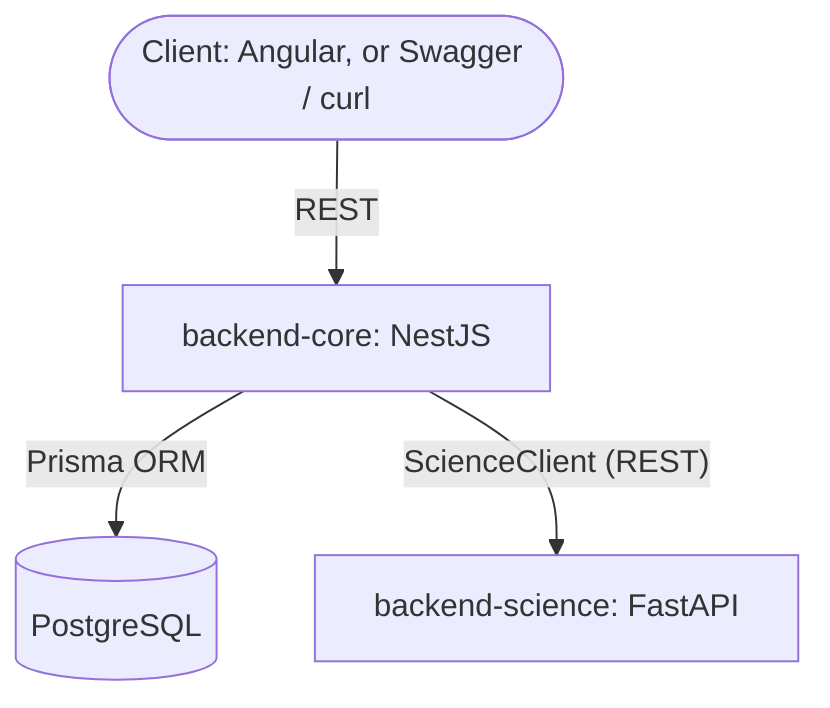

# Architecture overview

How the services fit together, where each responsibility lives, and the rules that hold across modules. Where v1 (the code at `v1.0.0`) differs from what the v2 design decided, both are stated.

## Services and boundaries

- **`backend-core`** (NestJS, TypeScript, Prisma, PostgreSQL) owns the whole transactional domain: accounts, transactions, categories, budgets, goals, analytics queries and, in v2, payees, rules, import templates, parsing, mapping, deduplication and the import preview ([ADR-0004](../adr/0004-stateless-import-staging.md)).
- **`backend-science`** (Python, FastAPI, pandas) only computes: forecasts, goal projections and, later, machine-learning suggestions. It is optional: when it is down, the core keeps working and only the computed extras are missing ([ADR-0005](../adr/0005-python-science-service-rest.md)).
- **Transport:** REST over HTTP, behind a `ScienceClient` interface in the core with timeouts, retries and a circuit breaker; NATS behind the same interface once a truly asynchronous job exists (D-21). The contract is in [science-contract.md](science-contract.md).
- **`client-preview`** (Angular) is part of the MVP, built screen by screen once each API is closed and tested (D-34).

**v1 difference:** the v1 import sends raw rows to Python (`POST /process`) for date and amount parsing and static categorisation; this goes away with the v2 import (#93). The HTTP proxy (`ScienceService`) has bounded timeouts, retries and HTTP errors since #85; `ScienceClient` replaces it in #96.

## Local deployment

`docker compose` (file `docker-compose.yaml`, variables from `.env.compose`) starts three containers on the `fn-network` network:

| Container | Service | Port | Notes |
| --- | --- | --- | --- |
| `fn-postgres` | PostgreSQL 17 | `${POSTGRES_PORT}` (5432) | Data in the `postgres_data` volume |
| `fn-core` | backend-core | `${SERVER_PORT}` (3000) | Swagger at `/docs`; on start it runs `prisma generate`, `prisma db push`, the seed and `start:dev` |
| `fn-science` | backend-science | `${SCIENCE_PORT}` (8000) | FastAPI docs at `/docs` |

How to run it: [development/setup.md](../development/setup.md).

## Backend core modules

Business logic lives in `backend-core/src/modules/`, one NestJS module per area, with the repository pattern (controllers → services → repositories → Prisma). Cross-cutting pieces (decorators, filters, interceptors, environment validation) live in `src/common/`.

- **v1 modules:** `transactions` (manual CRUD and `.xlsx` upload), `assets` (accounts), `categories`, `goals`, `analytics`, `science` (HTTP proxy to Python).
- **v2 adds:** payees, rules, import templates and the import preview, transfers, monthly budgets, and the `ScienceClient` interface. The MVP scope by area is in [product/vision.md](../product/vision.md#mvp-scope); the order of the work is in [product/roadmap.md](../product/roadmap.md).

## Consistency and precision

- **Atomic writes.** Operations that touch several rows (a transfer pair, a confirmed import) run in one Prisma transaction.
- **Derived balances.** In v2 no balance is stored or updated by deltas: balances, history and goal progress are computed from transactions ([ADR-0003](../adr/0003-derived-balances.md)). v1 still keeps `Asset.balance` and `AssetHistory` updated by deltas.
- **Decimal precision.** Money is `Prisma.Decimal` end to end. Incoming values go through `@ParseDecimal()`; outgoing values go through `@SerializeDecimal()`; a global `SerializeInterceptor` lets out only properties marked `@Expose()`. Aggregations happen in the database. **v1 difference:** distribution and monthly trends load every row and sum with `toNumber()` in memory (fixed by #95).
- **Dates.** Transactions carry a calendar date (`DATE`) and an optional local time; months and days are computed on the calendar date, never converted between time zones. The user's time zone (default Europe/Rome) only decides "today" and the date of transactions created by the app (D-30). **v1 difference:** `date` is a `DateTime`; trends group by UTC month and the budget by the server's local month.

## Multi-tenancy

Every model carries `userId`, with unique constraints and indexes scoped per user ([ADR-0001](../adr/0001-userid-on-all-models.md), D-18, from Schema v2).

Isolation is enforced by one mechanism, built before authentication (D-48):

1. A middleware puts the request's user into the request context (`nestjs-cls`). Until authentication exists it is a fixed, configured user; afterwards a JWT guard sets it (#62, #63).
2. A Prisma client extension adds `where: { userId }` to every query and sets `userId` on every create, so repositories do not filter by hand.
3. Raw SQL (`$queryRaw`) bypasses extensions: it reads the user from the context and filters on it explicitly.

**v1 difference:** `userId` exists only on `Asset`, `Category` and `SavingsGoal`, defaults to `"demo_user"`, and no query filters on it. Procedure for agents: [`.agents/workflows/multi-tenancy-flow.md`](../../.agents/workflows/multi-tenancy-flow.md).
