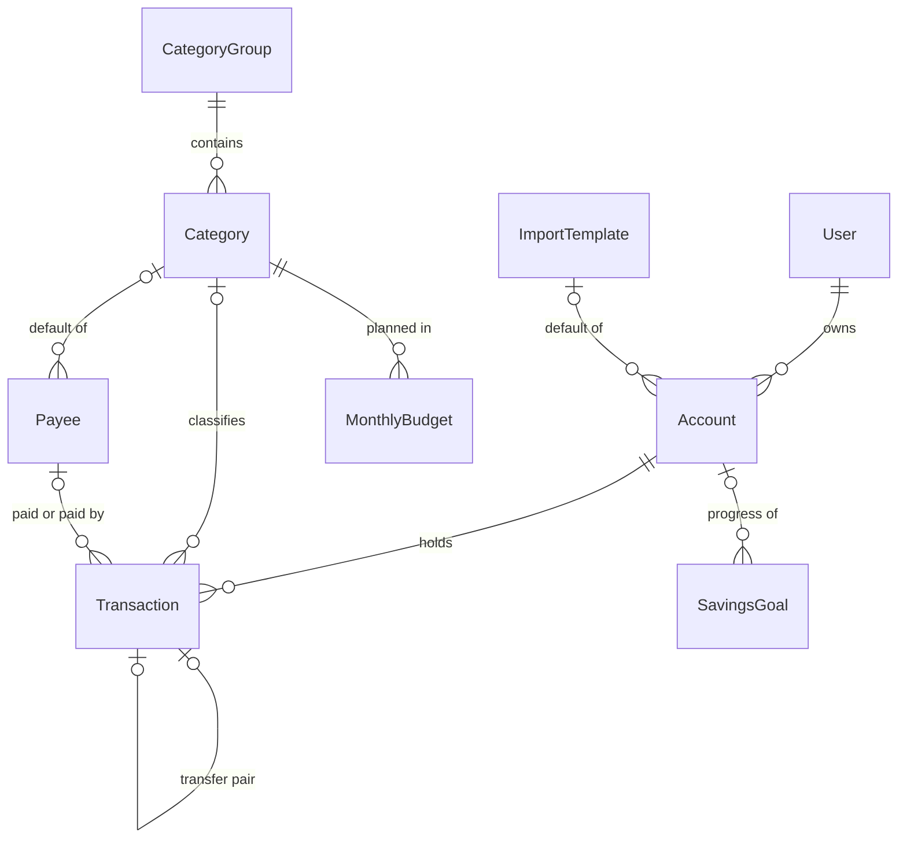

# Data model

The v2 data model: every model, field, relation and constraint, and the invariants that hold across them. Schema v2 (#89) implements it; a pull request that changes the schema updates this document in the same pull request. Terms are defined in the [glossary](../CONTEXT.md); how each area behaves is in the flow documents ([balances](../flows/balances.md), [transfers](../flows/transfers.md), [categories](../flows/categories.md)).

The ledger models (user, account, transaction, category group, category) are complete. The models of later areas (payee, rule, import template, monthly budget, savings goal) list their purpose, relations and the fields a decision already fixes; their remaining fields are completed together with their flow documents.

## Conventions

- **Identifiers.** Every model has a UUID `id`, generated by the database.
- **Owner.** Every model carries its own `userId`, including models whose owner could be reached through a relation ([ADR-0001](../adr/0001-userid-on-all-models.md), D-18). Unique constraints and indexes are scoped per user: they include `userId`, or a parent that belongs to one user. Isolation is enforced by the request context and a Prisma extension (D-48, [architecture § Multi-tenancy](../architecture/overview.md#multi-tenancy)). Every `userId` is a foreign key to [`User`](#user) (D-58).
- **Money.** Every amount is an integer number of cents, as in Actual Budget: a field of type *money* is an `Int` (32 bits, up to 21,474,836.47 per row). It stays in cents end to end: in the database, the core, the API and the computation service; the client turns it into euros for display, in one place (D-59). Every value computed from amounts, such as a balance, is in cents too (D-11), and sums are exact integer arithmetic. Only EUR in the MVP, recorded on `Account.currency` (D-07, D-59). How a percentage of an amount is rounded is defined in the budget flow.
- **Sign.** A positive amount brings money into the account, a negative amount takes it out, for every kind of transaction.
- **Dates.** A transaction has a calendar `date` (PostgreSQL `DATE`, no time zone) and an optional local `time` (`TIME`, no time zone). Months and days are computed on the calendar date, never converted between time zones. The user's time zone (default `Europe/Rome`) only decides what "today" is and the date of transactions created by the application (D-30).
- **Audit.** Every model has `createdAt` and, where rows change, `updatedAt` (`timestamptz`). They record when a row was written, not when the money moved.
- **No stored derived values.** Balances and goal progress are computed from transactions, never stored or updated by deltas ([ADR-0003](../adr/0003-derived-balances.md), D-11, D-26).
- **Names.** The models take the names of the [glossary](../CONTEXT.md), which are Actual Budget's: `Account`, `Transaction`, `MonthlyBudget`, not the v1 `Asset` and `EnrichedTransaction` (D-60).
- **User-visible names.** A name the user sees (an account, a category group, a category) is stored without leading and trailing spaces, and is unique within its scope ignoring case: "Home", "home" and "Home " collide (D-79). The scope is the user for accounts and groups, the group for categories (D-75); payees and import templates follow the same rule, defined in their flows.

## Models

Every model also belongs to a user; those relations are left out of the diagram.

### User

The owner of every other row. Until authentication exists, requests run as one fixed, configured user (D-48); authentication, roles and the demo sandbox are post-MVP (D-36). Every `userId` is a foreign key to this table, and the seed creates the fixed user (D-58); authentication will add columns to it.

| Field | Type | Required | Notes |
| --- | --- | --- | --- |
| `id` | UUID | yes | Referenced by `userId` on every model. |
| `timeZone` | text (IANA name) | yes | Default `Europe/Rome`. Decides "today" and the date of transactions created by the application (D-30). |
| `createdAt` | timestamptz | yes | |

### Account

Anything that holds money or value: a checking or savings account, a card, cash, an investment account, a property, a vehicle, a loan. Its balance is derived from its transactions; there is no balance column ([ADR-0003](../adr/0003-derived-balances.md), D-11).

| Field | Type | Required | Notes |
| --- | --- | --- | --- |
| `id` | UUID | yes | |
| `userId` | UUID | yes | |
| `name` | text | yes | Unique per user, ignoring case (D-79). |
| `type` | `AccountType` | yes | What the account is; see [Enumerations](#enumerations). |
| `isOnBudget` | boolean | yes | `true`: its transactions count as income and spending and feed the budget. `false`: tracked only for Net Worth, such as investments or a mortgage (D-07, D-25). Set at creation and never changed (D-64). |
| `currency` | text | yes | `EUR`, the only currency in the MVP (D-07, D-59). |
| `institution` | text | no | Bank or broker, for display. |
| `defaultImportTemplateId` | UUID → `ImportTemplate` | no | The template used when an upload names none (D-15, D-43). Deleting the template sets it to `null`. |
| `closedAt` | date | no | Set when the account is closed (D-63), back to `null` when it is reopened (D-81); see the [balances flow](../flows/balances.md#closing-and-deleting-an-account). |
| `createdAt`, `updatedAt` | timestamptz | yes | |

- Unique: `(userId, lower(name))` (D-79).
- An account with transactions other than its starting balance is closed, not deleted; an account without them is deleted. A forced deletion deletes its transactions and turns their transfer counterparts into `REGULAR` transactions (D-63, D-80). A closed account can be reopened (D-81).
- `isOnBudget` cannot change: it decides how past transfers and analytics count, so to change it the account is closed and a new one opened (D-64).

### Transaction

A dated movement of money or value on one account.

| Field | Type | Required | Notes |
| --- | --- | --- | --- |
| `id` | UUID | yes | |
| `userId` | UUID | yes | |
| `accountId` | UUID → `Account` | yes | Every transaction belongs to exactly one account: a balance is the sum of its account's transactions (D-11). |
| `kind` | `TransactionKind` | yes | `REGULAR`, `TRANSFER`, `STARTING_BALANCE` or `ADJUSTMENT` (D-25, [ADR-0008](../adr/0008-transaction-kind.md)). An `ADJUSTMENT` can be converted to `REGULAR` (D-69). |
| `date` | date | yes | Calendar date, as the bank gives it (D-30). |
| `time` | time | no | Local time, when the source provides one; used by deduplication (D-16, D-30). |
| `amount` | money | yes | Signed: positive in, negative out. |
| `categoryId` | UUID → `Category` | no | `null` means uncategorised (D-28). Only a category, never a group (D-27). Only on a `REGULAR` transaction or on the on-budget side of a `TRANSFER` that crosses the on/off-budget boundary (D-69, D-71). |
| `payeeId` | UUID → `Payee` | no | Who was paid or who paid (D-12, D-22). Always `null` on a `TRANSFER` (D-72). |
| `notes` | text | no | Plain free text; a rule can set it (D-23, D-78). Advanced notes are post-MVP (D-33). |
| `transferId` | UUID → `Transaction` | no | The other side of a transfer; set on both sides, only when `kind` is `TRANSFER` (D-24, D-70). |
| `description` | text | no | The bank's description as imported, kept for rules and deduplication (D-22, D-23). |
| `importedPayee` | text | no | The payee text from the bank after deterministic cleanup, before rules rename it (D-22). |
| `bankId` | text | no | The bank's unique transaction ID, when the template maps one (D-16). |
| `importHash` | text | no | Exact-match hash for re-imports (D-16); its composition is defined in the import flow. |
| `createdAt`, `updatedAt` | timestamptz | yes | |

- Unique: `(accountId, bankId)` and `(accountId, importHash)`, where not `null`. Uniqueness is per account, never global (D-16, [ADR-0007](../adr/0007-layered-deduplication.md)).
- Unique: `transferId`. A transaction is the counterpart of at most one other. Each side points to the other, and both are written in one database transaction (D-70).
- Indexes: `(userId, accountId, date)` for balances and history; `(userId, date)` for analytics; `(userId, categoryId)` and `(userId, payeeId)` for the category and payee views.
- Deleting a category or a payee goes through its flow (D-29), so these foreign keys restrict deletion instead of cascading.
- `STARTING_BALANCE` and `ADJUSTMENT` never have a category: they never count as income or spending (D-25), so a category on them would show in a category's transactions but not in its totals (D-69).

### CategoryGroup

A container of categories, such as "Home". It holds no transactions and no budget amounts (D-27).

| Field | Type | Required | Notes |
| --- | --- | --- | --- |
| `id` | UUID | yes | |
| `userId` | UUID | yes | |
| `name` | text | yes | Unique per user, ignoring case (D-79). |
| `isIncome` | boolean | yes | `true` for a group of income categories. Income, for the budget and the analytics, is the transactions in the categories of income groups, not the positive amounts (D-74). |
| `createdAt`, `updatedAt` | timestamptz | yes | |

- Unique: `(userId, lower(name))` (D-79). Groups have no parent, so a `NULL` parent can no longer let duplicate top-level names through.
- A user can have several income groups, and any of them can be deleted. A category never moves between an income group and a spending group, and a deletion never moves its contents across that line (D-74).

### Category

Where a transaction or a budget amount is classified, such as "Home › Utilities". Exactly two levels: a category always belongs to a group and never contains other categories (D-27).

| Field | Type | Required | Notes |
| --- | --- | --- | --- |
| `id` | UUID | yes | |
| `userId` | UUID | yes | |
| `groupId` | UUID → `CategoryGroup` | yes | |
| `name` | text | yes | Unique per group, ignoring case (D-75, D-79). Shown as "Group › Category". |
| `expenseType` | `ExpenseType` | no | The 50/30/20 classification: `NEEDS`, `WANTS` or `SAVINGS`; `null` means not classified (D-62). |
| `systemKey` | text | no | Stable key of a category created by the bootstrap, used to recognise it (translations, default rules). It does not protect the category: every category can be renamed and deleted (D-28). |
| `createdAt`, `updatedAt` | timestamptz | yes | |

- Unique: `(groupId, lower(name))`, so "Other" can exist in "Home" and in "Car", but "Other" and "other" cannot both exist in "Home" (D-75).
- Unique: `(userId, systemKey)`, where not `null`.

### Payee

The clean name of who was paid or who paid, such as "Esselunga", with an optional default category (D-12, D-22).

| Field | Type | Required | Notes |
| --- | --- | --- | --- |
| `id` | UUID | yes | |
| `userId` | UUID | yes | |
| `name` | text | yes | |
| `defaultCategoryId` | UUID → `Category` | no | Proposed for the payee's transactions when no rule sets a category (D-13). Moved by category deletion (D-29). |

Fields completed with the rules and payees flow.

### Rule

An ordered rule with conditions (all, or at least one) and actions: set payee, set category, set notes, mark as a transfer to an account. For each field, the first rule in the user's order that sets it wins (D-23).

| Field | Type | Required | Notes |
| --- | --- | --- | --- |
| `id` | UUID | yes | |
| `userId` | UUID | yes | |
| `position` | integer | yes | The user's order; unique per user (D-23). |

A "set category" action references a `Category` and is moved by category deletion (D-29). Fields completed with the rules and payees flow.

### ImportTemplate

A named, reusable mapping of a bank file: start row, columns, date format, sign convention, category values (D-15, D-43).

| Field | Type | Required | Notes |
| --- | --- | --- | --- |
| `id` | UUID | yes | |
| `userId` | UUID | yes | |
| `name` | text | yes | |

Fields completed with the import flow.

### MonthlyBudget

An amount planned for a category in a month: a fixed amount, or a percentage of the previous month's income (D-17, [ADR-0006](../adr/0006-monthly-tracking-budget.md)).

| Field | Type | Required | Notes |
| --- | --- | --- | --- |
| `id` | UUID | yes | |
| `userId` | UUID | yes | |
| `categoryId` | UUID → `Category` | yes | Never a group (D-27). Deleted with its category (D-29). |
| `month` | date | yes | The first day of the month. |

- Unique: `(categoryId, month)`.

Fields completed with the budget flow.

### SavingsGoal

A target amount whose progress is always computed: in the MVP, the balance of a dedicated account (D-26).

| Field | Type | Required | Notes |
| --- | --- | --- | --- |
| `id` | UUID | yes | |
| `userId` | UUID | yes | |
| `name` | text | yes | |
| `targetAmount` | money | yes | |
| `accountId` | UUID → `Account` | no | The dedicated account whose balance is the progress (D-26). |
| `status` | `GoalStatus` | yes | Only the states set by hand; "reached" is computed (D-26). |

Fields completed with the goals flow.

## Enumerations

### TransactionKind

What a transaction is (D-25, [ADR-0008](../adr/0008-transaction-kind.md)). The kinds are mutually exclusive.

- `REGULAR`: income or spending.
- `TRANSFER`: one side of a transfer between two of the user's accounts (D-24).
- `STARTING_BALANCE`: the balance an account opens with (D-11).
- `ADJUSTMENT`: a change of value without a real movement: a reconciliation difference or a revaluation (D-07, D-11).

### AccountType

What an account is, for grouping in the Net Worth (D-61). The type changes no rule: `Account.isOnBudget` decides how its transactions count.

- `CHECKING`: checking accounts.
- `SAVINGS`: savings and deposit accounts.
- `CREDIT_CARD`: credit cards.
- `CASH`: cash.
- `INVESTMENT`: stocks, ETFs, funds, crypto, pension funds.
- `PROPERTY`: real estate.
- `VEHICLE`: cars, motorcycles, boats.
- `LOAN`: mortgages and loans; their balance is negative.
- `OTHER`

### ExpenseType

The 50/30/20 classification of a category (D-62): half of income to needs, 30% to wants, 20% to savings. Which view reads it is defined in the analytics and budget flows.

- `NEEDS`: essential spending, such as rent, utilities, groceries.
- `WANTS`: discretionary spending, such as restaurants, travel.
- `SAVINGS`: savings, investments, debt repayment.

### GoalStatus

The states of a savings goal that are set by hand (D-26).

- `ACTIVE`
- `PAUSED`
- `ARCHIVED`

## Invariants

1. Every row has a `userId`, and two users never collide on a unique constraint: the same group name, account name or bank ID can exist once for each user. **Exercised by:** DM-2, DM-4.
2. Every transaction belongs to exactly one account. **Exercised by:** DM-5.
3. The balance of an account at a date is the sum of the amounts of its transactions dated up to that date, whatever their kind and whenever they were written. No balance is stored. **Exercised by:** BAL-1, BAL-5, BAL-7.
4. Money is exact: amounts are integers in cents, so their sums never lose a cent. **Exercised by:** DM-3.
5. A transaction's date is a calendar date and its month is the month of that date, with no time zone conversion. **Exercised by:** DM-1.
6. Every transaction has exactly one kind. **Exercised by:** BAL-2, BAL-5, TRF-1.
7. A transfer is two `TRANSFER` transactions on two different accounts of the same user, with opposite amounts, each pointing to the other; neither exists without the other. **Exercised by:** TRF-1, TRF-3, TRF-5, TRF-8.
8. A transfer between two on-budget accounts, or between two off-budget accounts, has no category on either side (D-25, D-28). **Exercised by:** TRF-1, TRF-7.
9. A transaction's category, when present, is a category, never a group; `null` means uncategorised. **Exercised by:** CAT-1, CAT-3.
10. Categories have exactly two levels: a group contains categories, a category contains nothing. **Exercised by:** CAT-2.
11. Names ignore case and surrounding spaces when compared: account and group names are unique per user, category names per group. **Exercised by:** CAT-9, CAT-12, DM-2.
12. A bank ID or an import hash appears at most once per account. **Exercised by:** DM-4.
13. Only a `REGULAR` transaction, or the on-budget side of a `TRANSFER` that crosses the on/off-budget boundary, has a category. **Exercised by:** BAL-5, BAL-11, TRF-2, TRF-6.
14. Every account has exactly one `STARTING_BALANCE` transaction, and no transaction is dated before it. **Exercised by:** BAL-5, BAL-6.

## v1 differences

| v1 | v2 | Why |
| --- | --- | --- |
| `Asset.balance` updated by deltas, `AssetHistory` daily snapshots | No stored balance; balance and history computed from transactions | D-11, [ADR-0003](../adr/0003-derived-balances.md) |
| `userId` on three models, default `"demo_user"`, never filtered | `userId` on every model, a foreign key to `User`, enforced by the request context | D-18, D-48, D-58, [ADR-0001](../adr/0001-userid-on-all-models.md) |
| `EnrichedTransaction.assetId` optional, set to `null` when the asset is deleted | `accountId` required | D-11 |
| `Asset`, `EnrichedTransaction` | `Account`, `Transaction` | D-60 |
| `amount` `Decimal(10,2)`, balances `Decimal(15,2)`, `Prisma.Decimal` in the code | Integer cents everywhere | D-59 |
| `AssetType`: `CASH`, `INVESTMENT`, `REAL_ESTATE`, `VEHICLE`, `DEBT`, `OTHER` | `AccountType`: checking, savings, credit card, cash, investment, property, vehicle, loan, other | D-61 |
| `Category.type` (`ExpenseType`), default `UNCLASSIFIED` | `Category.expenseType`, `null` when not classified | D-62 |
| `date` `DateTime` | `date` `DATE` plus optional `time` | D-30 |
| No transaction kind; transfers count as spending and income | `kind`, transfers as linked pairs | D-24, D-25 |
| `transactionHash` unique across the whole database; manual transactions have none | `bankId` and `importHash` unique per account, plus approximate matching | D-16, [ADR-0007](../adr/0007-layered-deduplication.md) |
| `RawTransaction` rows saved on every upload | No staging data; the preview is stateless | D-06, [ADR-0004](../adr/0004-stateless-import-staging.md) |
| Self-referencing `Category`, a third level possible, duplicate top-level names possible | `CategoryGroup` and `Category`, exactly two levels | D-27 |
| `UNCATEGORIZED` system category, `isSystem`, `isVerified` | `categoryId = null`; `systemKey` only | D-28 |
| `Category.defaultAssetId`, `Category.defaultGoalId` | Removed: the account is chosen at upload, goals follow an account | D-15, D-26 |
| `BudgetRule`: one cap per category for every month | `MonthlyBudget` per (category, month) | D-17, [ADR-0006](../adr/0006-monthly-tracking-budget.md) |
| `SavingsGoal.currentAmount` updated by deltas; `COMPLETED` set by hand only | Progress computed; "reached" computed; `ARCHIVED` and `PAUSED` by hand | D-26 |

## Not in the MVP schema

- `Holding` (instrument, quantity, price) and `ExchangeRate`: multiple currencies and automatic prices are post-MVP; investments are off-budget accounts with value adjustments (D-07).
- `Subscription` (Actual Budget's schedules): post-MVP (D-12, D-36).
- Authentication and roles on `User`: post-MVP (D-36, [open questions](../product/open-questions.md)).
- Split transactions, tags, hidden categories: post-MVP (D-12, D-33).
- Shares of a common account between several goals: post-MVP (D-26).

## Examples

### DM-1 · A calendar date has no time zone

- **Given** the user's time zone is `Europe/Rome`
- **And** a bank file has a payment dated 01/11/2026 at 00:30
- **When** the payment is saved
- **Then** its `date` is `2026-11-01` and its `time` is `00:30`
- **And** it belongs to November 2026 wherever the server runs, although in UTC the same instant falls on 31 October

### DM-2 · Unique constraints are per user

- **Given** user A has a category group "Home"
- **When** user B creates a category group "Home"
- **Then** it is created
- **When** user A creates a second category group "Home"
- **Then** the database rejects it

### DM-3 · Amounts are exact

- **Given** an account opened with a starting balance of 0.10, stored as `10`
- **When** transactions of 0.20 (`20`) and −0.30 (`-30`) are added on the same day
- **Then** the balance is exactly `0`, shown as 0.00, with no floating-point remainder
- **And** the API returns the amounts as `10`, `20` and `-30`

### DM-4 · Bank IDs are unique per account

- **Given** a transaction on account "Checking" with bank ID `TX-1`
- **When** a transaction with bank ID `TX-1` is saved on account "Card", or by another user
- **Then** it is saved
- **When** a second transaction with bank ID `TX-1` is saved on "Checking"
- **Then** the database rejects it

### DM-5 · A transaction always has an account

- **Given** the user has accounts "Checking" and "Card"
- **When** a transaction is created without an account
- **Then** it is rejected
