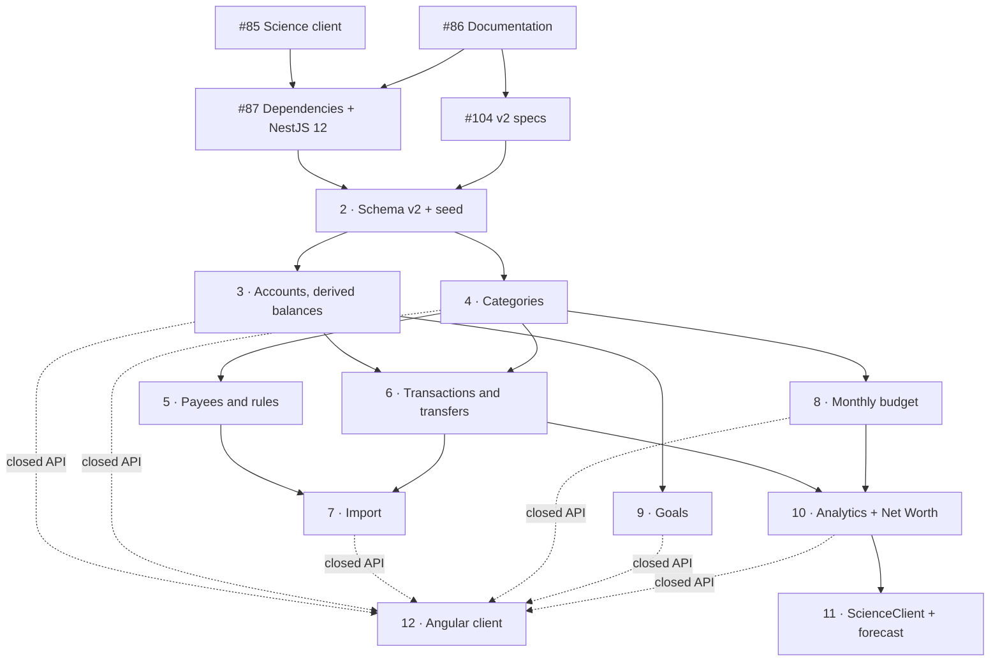

# Roadmap

The v2 plan: milestones, the steps inside them and their order, how releases are tagged, how every milestone is closed, and the risks being watched. **Status is not tracked here**: see the [milestones](https://github.com/fabogit/finances-dashboard/milestones) and the project "Finance Dashboard Roadmap" on GitHub.

The plan rewrites the schema once, then rebuilds the modules flow by flow in dependency order (D-37), test-first from the examples in the specs (D-38, D-46). The code reuses what still fits (configuration, CI, Docker, validation, Decimal serialisation, module structure).

## Milestones

Six MVP milestones grouped by theme, plus two after the MVP (D-45). Each MVP milestone ends with its own Review & consolidation issue ([below](#review--consolidation)).

- **M1 · Groundwork** — fixes that survive the redesign, documentation restructured with agent entry files, dependencies refreshed (NestJS 12), and the v2 specs. Step 1.
- **M2 · Ledger** — Schema v2 and the profile-based seed, accounts with derived balances, category groups, transactions with `kind` and transfers. Steps 2, 3, 4, 6.
- **M3 · Import** — payees and rules, then the guided import: templates, column mapper, stateless preview, layered deduplication, transfer detection. Steps 5, 7.
- **M4 · Planning** — monthly budget per category and savings goals on a dedicated account. Steps 8, 9.
- **M5 · Insights** — analytics aggregated in the database with the `kind` rules, Net Worth history, a robust `ScienceClient` with the adapted forecast. Steps 10, 11.
- **M6 · Client** — the minimal Angular client, one screen per closed API. Step 12. Closing M6 is the MVP, `v2.0.0`.
- **Post-MVP · Auth & multi-tenancy** — users, authentication, roles and the demo sandbox (#62–#65). Designed after the MVP; questions in [open-questions.md](open-questions.md).
- **Post-MVP · Backlog** — accepted ideas outside the MVP: subscriptions (#78), forecast split (#77), multiple currencies (#81), the HTTP `QUERY` method (#80), the native HTTP adapter (#88).

## Steps

1. **Groundwork** (M1)
   - Science client: timeouts, retries and real HTTP errors (#85).
   - Documentation restructured, ADRs, roadmap, `AGENTS.md` (#86).
   - Dependency refresh and NestJS 12 (#87), after #85 and #86.
   - **v2 specs: data model and flow documents (#104)**, after #86 and **before Schema v2**: the data model and one flow document per MVP area, with numbered Given / When / Then examples (D-46, D-47).
2. **Schema v2** (#89) and the **profile-based seed** (#90) (M2). Done alone, with no other session touching the code.
3. **Accounts with derived balances** (#91): starting balance, reconciliation, adjustments (M2).
4. **Category groups and categories** (#92), with deletion that moves everything to a chosen category (M2).
5. **Payees and rules** (#79) (M3).
6. **Transactions with `kind`, and transfers** (#74) (M2).
7. **Guided import** (#93): templates, mapper, preview, deduplication, transfer detection (M3).
8. **Monthly budget per category** (#75) (M4).
9. **Savings goals on a dedicated account** (#94) (M4).
10. **Analytics aggregated in the database** (#95) and **Net Worth history** (#61) (M5).
11. **`ScienceClient` and the adapted forecast** (#96) (M5).
12. **Minimal Angular client** (#97), screen by screen: accounts, import, transactions, categories, budget, dashboard (M6).

Every step ends with tests green, its flow document current and the seed updated. Large steps are split into more issues when they are reached, not before: issues for distant steps are written better once the earlier ones are closed.

### Dependencies

### Working in parallel

- **The schema is the bottleneck:** everything after step 2 depends on it. No two open sessions change `schema.prisma` at the same time.
- **At most two issue sessions at once.** The limit is the maintainer's attention for reports and reviews, not the tooling.
- Pairs that work together: #85 with #86; #104 with #85 or #87 (it only touches `documents/` and `AGENTS.md`); steps 3 and 4; steps 8 and 9; a client screen with the next backend step.

## Versioning

One version for the whole repository (D-42):

- `v1.0.0` is the first generation, the system before the redesign.
- Each step closes with a pre-release on `main`: `v2.0.0-alpha.1`, `v2.0.0-alpha.2`, …; then `v2.0.0-beta.N` once the client is in; the MVP is `v2.0.0`. Tags go per step, not per milestone.
- Tags are annotated, on the merge commit on `main`, after a release commit that aligns the version in `backend-core/package.json`, `client-preview/package.json` and `__version__` in `backend-science/src/main.py`.
- The changelog comes from the Conventional Commits; release-please is evaluated after `v2.0.0-alpha.2`.

## Review & consolidation

Every milestone M1–M6 ends with an `M<N> · Review & consolidation` issue (#98–#103) that depends on all the other issues of the milestone. Per-issue verification looks at one pull request at a time; this step catches what only shows across pull requests.

1. **Analysis**, read-only, on `main`: one agent per dimension, and an adversarial check of each finding. The dimensions:
   - documentation conformance: code against `documents/`, flows, ADRs, and the specs against the code (D-46);
   - bugs and edge cases, especially `Decimal` precision, calendar dates and per-user scoping;
   - duplication and dead code across the milestone's pull requests;
   - test gaps, especially across the core ↔ science boundary;
   - security and input validation;
   - dependencies (`pnpm outdated`, `pip list --outdated`);
   - the `demo` seed profile exercises what the milestone added;
   - the agent workflows in `.agents/workflows/` still match the code and the commands;
   - an end-to-end check with `docker compose`.
2. **Findings** posted as one checklist comment on the issue, each tagged **bug**, **refactor**, **docs** or **defer**.
3. **Triage** with the maintainer: fix now, new issue in a later milestone, or drop. Fix now only code this milestone delivered, without abstractions for later steps.
4. **Fixes** in small pull requests, one per theme, bug fixes separate from refactors, tests green before and after. The last pull request closes the issue. A new decision gets an ADR or goes in its flow document.
5. **Close-out:** `documents/` current, [open risks](#open-risks) updated, a short retro as a comment on the issue.

M1 (#98) pilots the step.

## Open risks

- **Documentation drifting from the code.** The v1 documents had drifted far enough to contradict the code and each other; the redesign started from there. Mitigated by writing the specs before the code (D-46), by the Definition of Done (every behaviour change updates its spec) and by the conformance check in every Review & consolidation.
- **The schema as a bottleneck.** Every step after 2 depends on Schema v2 (#89). Mitigated by declaring in the issue when it touches the schema and never having two open sessions on it; with `db push` and a reset a conflict can be resolved, but it costs.
- **Database sync method tied to CI and scripts.** The schema is applied with `prisma db push` until the MVP, then a `prisma migrate` baseline (D-19). Every place that applies the schema (Dockerfile, CI, scripts) must follow the same method ([`AGENTS.md` § Database sync method](../../AGENTS.md#database-sync-method)): a mismatch already broke CI once (fixed in #83). **Carried forward (#89):** `prisma:migrate`, `prisma:reset`, `prisma:deploy` and `db:test:migrate` are leftovers of `migrate` and are not used until the baseline.
- **No durable data before the migrate baseline.** `db push` with resets erases the database, so the maintainer's own data cannot live in it yet. Accepted: imports must be repeatable, the bank files stay the source, and the baseline comes when the MVP closes, before any data that cannot be rebuilt.
- **Per-user isolation not yet enforced.** v1 does not isolate users ([architecture § Multi-tenancy](../architecture/overview.md#multi-tenancy)), and there is no authentication until the post-MVP milestone. **Planned (D-48):** the request context and the Prisma extension that enforce isolation are built in M2, with a fixed user until authentication; part of #63 therefore moves into M2 and must be assigned to an issue (#89 or a new one). Until authentication exists, nothing beyond the generated `demo` data should be exposed publicly.
- **Science "no result" outcomes still answered as 200 with an error body.** Since #85, failed calls to Python get timeouts, retries and real HTTP errors (502, 503, 504). Insufficient history, invalid dates and unreachable goals are still passed through as `200 { error }`. They follow D-49 (422 for insufficient data, an explicit outcome for unreachable goals) and land with `ScienceClient` (#96) or the forecast and goals issues, still to be assigned.
- **Analytics in memory and in floating point.** In v1 distribution and monthly trends load every row and sum with `toNumber()`; the issue that claimed otherwise (#76) was closed without the work. Rewritten in the database by #95.
- **Toolchain constraints (#87).** `typescript-eslint` required TypeScript `<6.1` (checked 2026-10-13), which may hold TypeScript 7 back; Prisma 8 is a release candidate, so the project stays on Prisma 7; `@nestjs/platform-node` is not on npm yet (#88); the build writes `dist/src/main.js` while `start:prod` runs `dist/main`.
- **An incomplete application between steps 2 and 11.** The modules are rewritten one flow at a time, so the application is not usable end to end in between. Accepted: there are no external users.
